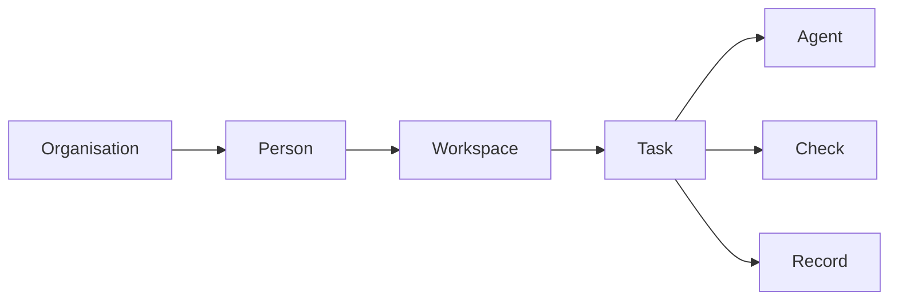
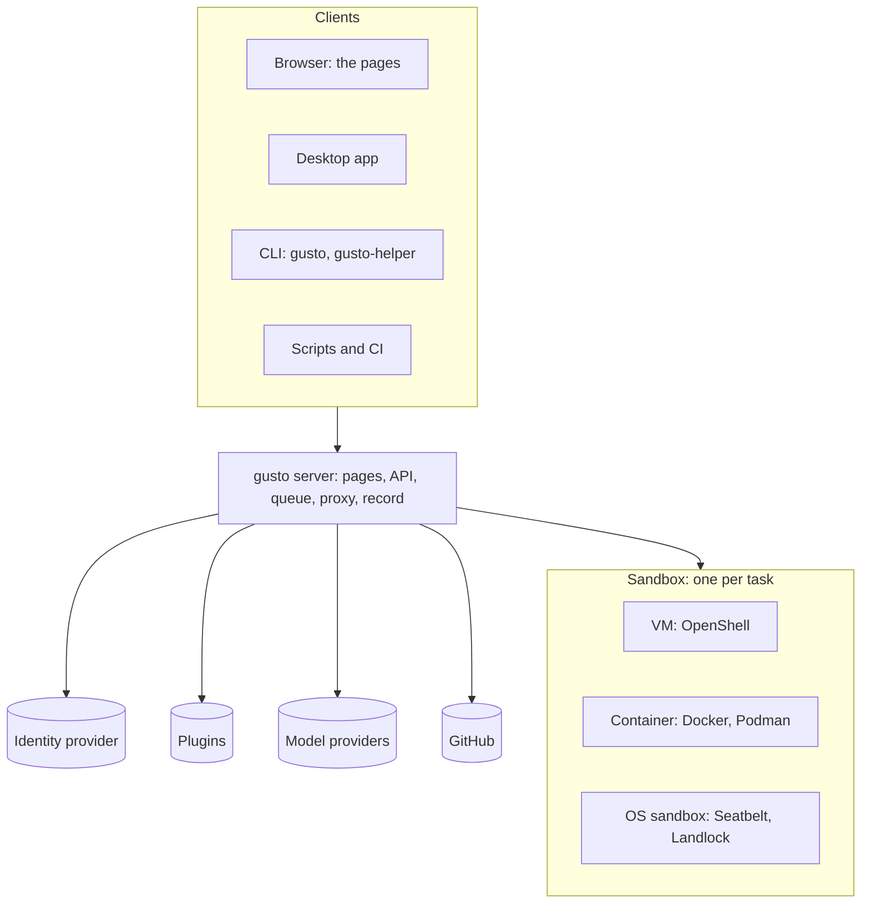
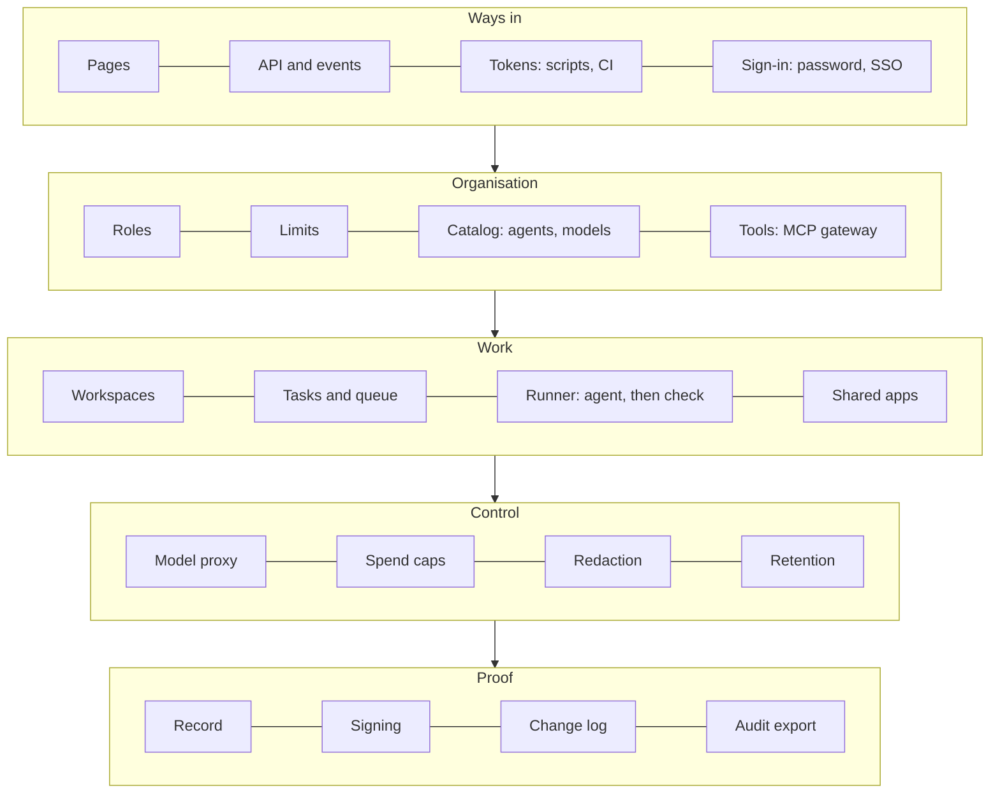
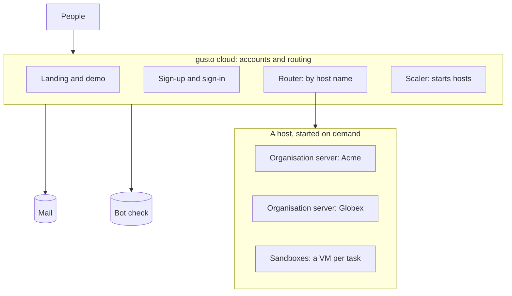

# Architecture

gusto is one server and one record format. The same server runs on a laptop, on a server you own, and inside the hosted cloud. A person reaches it by browser, desktop app, command line or script, all through one HTTP protocol ([PROTOCOL.md](PROTOCOL.md)).

Four views show the system. Each answers one question.

| View | Question | Section |
| --- | --- | --- |
| Concepts | What do I work with? | [The concepts](#the-concepts) |
| Components | What is it made of? | [The components](#the-components) |
| Deployment | Where does it run? | [Where it runs](#where-it-runs) |
| Flow | What happens to one task? | [One task](#one-task) |

[Where each concept lives](#where-each-concept-lives) connects the first two.

## The concepts



An organisation is a company or team. It has people, settings, a spend limit and its own server. Each person has one workspace in it, where their agents run and keep their files. A person gives a task to an agent. The check says whether the task passed. The record keeps what changed and can be re-checked by anyone.

## The components

Around the server:



Inside the server, in five layers:



The agent reaches a model only through the proxy, which adds the key and counts the tokens.

## Where each concept lives

| Concept | Implemented as | Lives in |
| --- | --- | --- |
| Organisation | One `gusto serve` process with its own data directory, signing key, spend ledger and change log | The organisation's server |
| Person and role | An account and a sign-in: password, SSO or token | The server, or gusto cloud in the hosted cloud |
| Workspace | One sandbox per person that keeps their files | The host that runs the organisation's server |
| Task | A directory holding the brief, the repository, the check and the spend limit | The organisation's data directory |
| Agent | An adapter: a small JSON file that names the agent type | Inside the sandbox |
| Check | A command run at the end. Its exit code is the verdict | Inside the sandbox |
| Spend limit | A cap that the proxy counts against and enforces | The model proxy |
| Record | Hashed files, the check result and a signature | The task directory. `gusto verify` re-checks it anywhere |

## Where it runs

| You are | You run | Isolation for tasks |
| --- | --- | --- |
| One person | `gusto local install`, a service on your computer | A VM, a container, or the system sandbox: the strongest your machine has |
| A team on a server | `server.sh`, Compose or Helm: one `gusto serve` | A container |
| A company | The same server in its own cloud, with SSO | A container or a VM |
| Us, hosted | `gusto cloud` with one server per organisation | A VM per task (OpenShell) |



Each organisation has its own server, data directory, signing key and spend ledger. gusto cloud holds accounts and routes by host name. It runs no tasks. A host starts when an organisation waits and stops after ten idle minutes. See [CLOUD.md](CLOUD.md).

## One task

```mermaid
sequenceDiagram
  participant Person
  participant Server as gusto server
  participant Box as Sandbox
  participant Model
  Person->>Server: submit the task, the agent, the check, the spend limit
  Server->>Box: start one sandbox
  Box->>Server: ask for a model through the proxy
  Server->>Model: add the key, count the tokens
  Model-->>Box: reply
  Box->>Server: finished, with the files it changed
  Server->>Server: run the check, hash the files, sign the record
  Server-->>Person: the result and the record
  Person->>Person: gusto verify, on any machine
```

## Terms

| Word | Meaning | Older name in the code and commands |
| --- | --- | --- |
| organisation | A company or team account | |
| workspace | One person's place in an organisation, kept between tasks | computer |
| task | One piece of work for an agent | job |
| agent | The worker a task is given to. Both the program (Claude Code, Codex, OpenCode, pi, Hermes or DeepSeek Agent) and a person's own named setup, such as "Finance helper" | harness, engine |
| agent type | The program: Claude Code, Codex, OpenCode, pi, Hermes or DeepSeek Agent. Said when it must be told apart from a named agent | harness, engine |
| named agent | An agent a person saved with a name, based on an agent type: "Finance helper, based on Claude Code" | |
| check | The command whose result says pass or fail | gate |
| record | What a task leaves behind: hashed files, the check result, a signature | evidence |
| sandbox | The isolated box one task runs in | wall (the level) |
| host | A machine that runs organisation servers and their sandboxes | cell |
| gusto cloud | The hosted server for accounts and routing | front door |
| operator | The person who runs a hosted gusto | owner |
