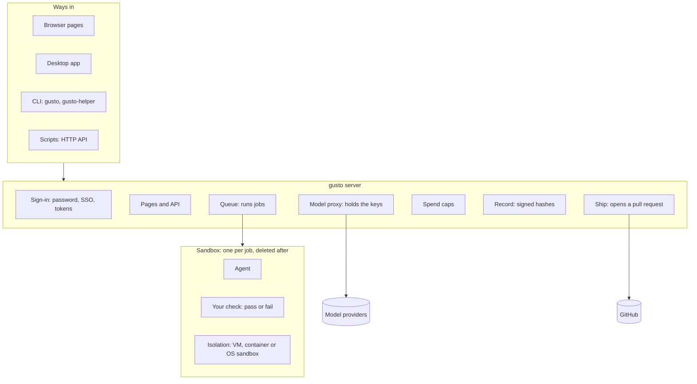
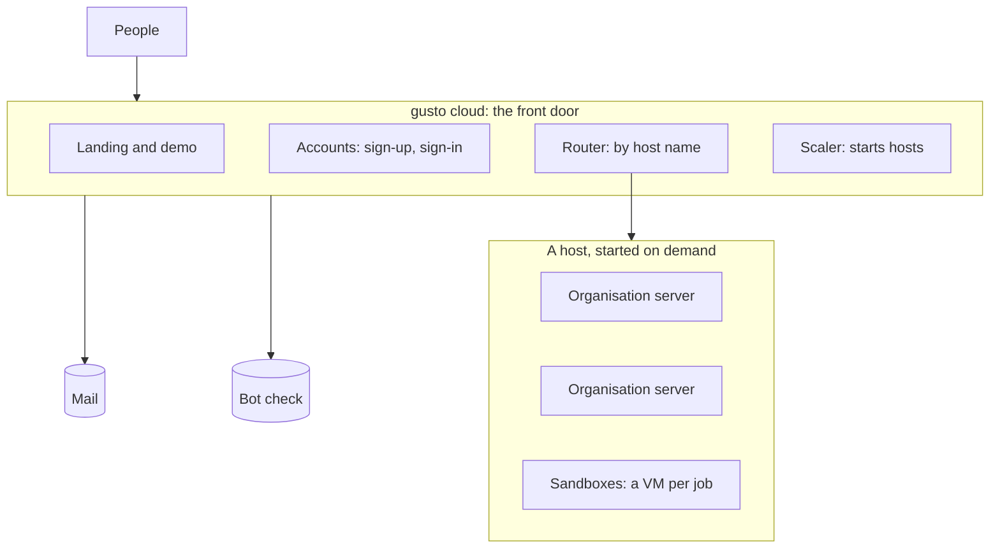

# Architecture

gusto is one server and one record format. The same server runs on a laptop, on a server you own, and inside the hosted cloud. A person reaches it by browser, desktop app, command line or script, all through one HTTP protocol ([PROTOCOL.md](PROTOCOL.md)).

## One server

A job is a directory: the task, the repository, the check command and the spend limit. The agent works inside a sandbox and reaches a model only through the proxy, which adds the key and counts the tokens. When the job ends, the server hashes what changed, runs the check, and signs the record. `gusto verify` re-checks the record on any machine, with no help from the server.

## Hosted cloud

Each organisation has its own server, data directory, signing key and spend ledger. The front door holds accounts and routes by host name. It runs no jobs. A host starts when an organisation waits and stops after ten idle minutes. See [CLOUD.md](CLOUD.md).

## Where it runs

| You are | You run | Isolation for jobs |
| --- | --- | --- |
| One person | `gusto local install`, a service on your computer | A VM, a container, or the system sandbox: the strongest your machine has |
| A team on a server | `server.sh`, Compose or Helm: one `gusto serve` | A container |
| A company | The same server in its own cloud, with SSO | A container or a VM |
| Us, hosted | `gusto cloud` with one server per organisation | A VM per job (OpenShell) |

## Terms

| Word in gusto | Meaning |
| --- | --- |
| job | One task for an agent, kept in a directory |
| agent | Claude Code, Codex, OpenCode, pi, Hermes or DeepSeek Agent. The code and flags call it a harness |
| check | The command whose result says pass or fail. The code and flags call it the gate |
| record | What a job leaves behind: hashed files, the check result and a signature. The code calls it evidence |
| sandbox | The isolated box one job runs in |
| server | `gusto serve`: pages, API, queue and proxy in one process |
| front door | `gusto cloud`: accounts and routing for the hosted cloud |
| host | A machine that runs organisation servers and their sandboxes. The code calls it a cell |
| computer | One person's agent workspace inside an organisation |
